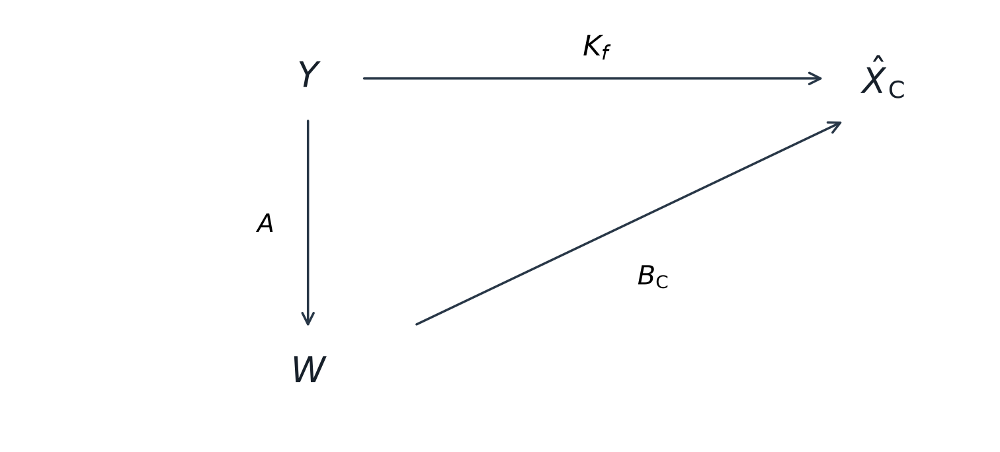
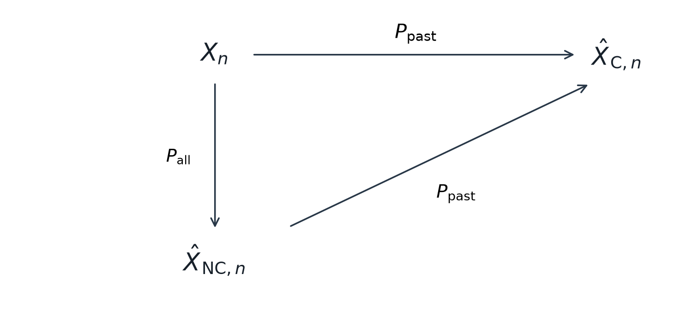
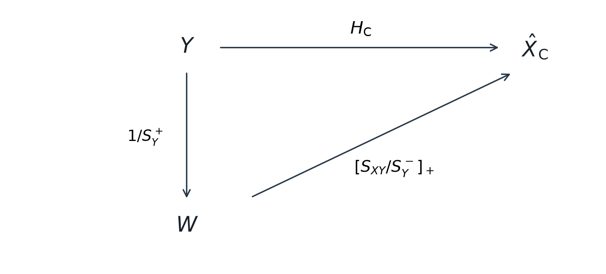
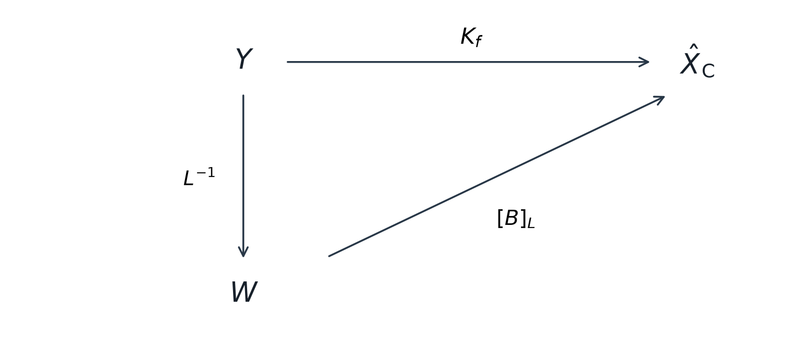
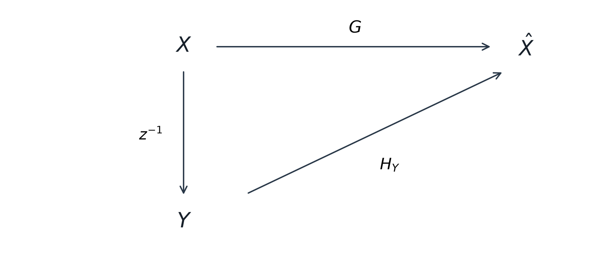
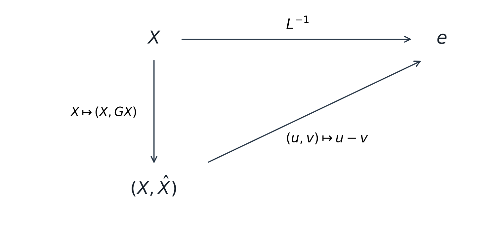
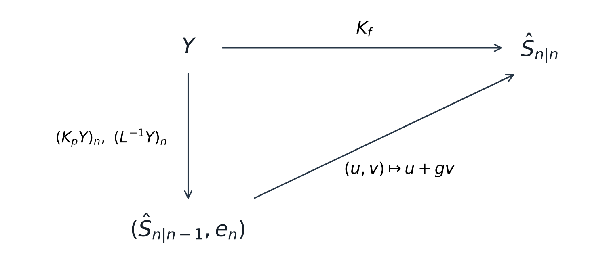

# 因果维纳滤波、预测与新息

从非因果估计到实时滤波，再到预测，改变的是允许使用的信息。贯穿这些问题的思想是：把观测正交化，让各部分信息的贡献可以分别计算，再施加时间上的限制。

## 1 任务先行：目标是什么，拿什么当观测

| 任务 | 目标 | 可用信息 | 直觉 |
|---|---|---|---|
| 非因果估计／平滑 | 当前目标 Xₙ | 全部观测，包括未来 | 事后回看，用更多线索还原 |
| 因果滤波 | 当前目标 Xₙ | 当前及过去的观测 Y | 当前读数已经到达 |
| 一步预测 | 当前值 Xₙ | Xₙ₋₁、Xₙ₋₂、… | 当前还没看到，只根据真实历史猜 |
| 带噪声历史的预测 | 干净信号 Sₙ | 过去的带噪声读数 Y | 连过去也只能通过测量了解 |
| 带噪声的当前滤波 | 干净信号 Sₙ | 当前及过去的带噪声读数 | 新读数到达后修正预测 |

维纳估计不要求观测一定具有“目标加噪声”的形式。过去的目标值也能充当观测，因为它与当前目标相关。最优均指最小均方误差意义下的线性最优，不自动意味着在所有非线性方法中最优。

以下过程默认零均值或已去均值、二阶矩有限；频域部分使用联合宽平稳假设。谱因子部分沿用有理谱、有限功率、单位圆上严格为正的条件。有限向量部分假设观测二阶矩矩阵正定，不要求平稳。非零均值若采用仿射估计，可先中心化，最后加回目标均值。

## 2 怎样读交换图

节点是数据，箭头是操作。交换图表达的是：从同一个起点沿不同路径计算，会得到同一个终点。不是说箭头上的矩阵可以任意交换乘法顺序。



上方路径直接估计；下方路径先白化再估计。图对应的等式是

```math
K_fY=B_{\mathrm C}(AY),\qquad K_f=B_{\mathrm C}A.
```

先执行的变换写在乘积右边。恒等映射 $`\mathrm{id}`$ 表示“原样输出”，这里无需为了凑四边形添加它。

## 3 从非因果到因果：为什么不能直接删未来项

非因果维纳滤波允许使用全部观测：

```math
\hat X_{\mathrm{NC},n}=\sum_{k\in\mathbb Z}h_kY_{n-k},
\qquad H_{\mathrm{NC}}=\frac{S_{XY}}{S_Y}.
```

因果限制要求只保留当前和过去，即系数仅能在 $`k\ge0`$ 非零。直接取 $`[H_{\mathrm{NC}}]_+`$ 能得到因果滤波器，但通常不再最优：原系数是在过去、当前、未来共同参与时确定的，删除未来后，其余权重通常需要调整。

例如 $`Y_0=X+Z_0`$、$`Y_1=X+Z_1`$，其中三个随机变量零均值、方差为 1、互不相关。使用两次读数的最优估计为 $`(Y_0+Y_1)/3`$。删除未来读数得到 $`Y_0/3`$，但只用当前读数的最优估计实际是 $`Y_0/2`$。

### 正交化为什么有效

若观测分量 $`W_i`$ 彼此正交，则

```math
\hat X=\sum_i b_iW_i,
\qquad b_i=\frac{E[XW_i^*]}{E|W_i|^2}.
```

每个最优系数只涉及对应分量，不涉及其他系数。对同一目标、同一统计模型，增减一个正交观测，不需要调整其他最优系数。因此，白化后才能通过直接删除未来系数得到因果最优解。

### 嵌套投影：先利用全部信息，再投影到过去

记 $`P_{\mathrm{all}}`$ 为投影到全部观测的闭线性空间，$`P_{\mathrm{past}}`$ 为投影到截至当前的观测空间。



直接根据过去估计真实目标，与根据过去估计“全部信息下的最优估计”，结果相同：

```math
P_{\mathrm{past}}P_{\mathrm{all}}X_n=P_{\mathrm{past}}X_n.
```

理由是非因果残差与全部观测正交。对任何只用当前和过去的估计 $`V`$，

```math
E|X_n-V|^2
=E|X_n-\hat X_{\mathrm{NC},n}|^2
+E|\hat X_{\mathrm{NC},n}-V|^2.
```

第一项不随 $`V`$ 改变，所以两个优化任务等价。这个结论不要求白观测；白性用于进一步把投影实现为直接截断系数。

## 4 谱因子分解：找到可因果逆转的白化变换

规范谱因子分解为

```math
S_Y(z)=L(z)r_eL^*(z^{-*}),\qquad z^{-*}=1/z^*,
\qquad L(\infty)=1.
```

$`L`$ 最小相位：自身及其逆都因果、稳定。它作为建模滤波器，把功率为 $`r_e`$ 的白过程变成具有观测功率谱的过程；其逆则完成白化。两个方向都因果，使当前及过去的信息在转换前后保持等价。

在单位圆上定义

```math
S_Y^+(\omega)=\sqrt{r_e}L(e^{j\omega}),
\qquad S_Y^-(\omega)=(S_Y^+(\omega))^*,
\qquad S_Y=S_Y^+S_Y^-.
```

这是模平方分解，不是把谱分成正、负频率两半，也不是直接取非负实平方根作为滤波器。功率谱只规定幅度平方，相位还需要通过最小相位等条件确定。

例如

```math
5+4\cos\omega=4|1+0.5e^{-j\omega}|^2.
```

可取 $`r_e=4`$、$`L=1+0.5z^{-1}`$。因此 $`S_Y^+=2+e^{-j\omega}`$。$`L^{-1}`$ 输出功率为 4 的白过程，$`1/S_Y^+`$ 输出单位功率白过程。

### 因果维纳解的交换图



下方路径先做单位功率白化，再对白观测进行最优因果估计。因为

```math
S_W=1,\qquad S_{XW}=S_{XY}(1/S_Y^+)^*=S_{XY}/S_Y^-,
```

白化后的非因果解就是 $`S_{XY}/S_Y^-`$，删除未来项便得到

```math
\boxed{H_{\mathrm C}=\frac1{S_Y^+}\left[\frac{S_{XY}}{S_Y^-}\right]_+.}
```

### 截断运算与快速计算

$`[\cdot]_+`$ 保留冲激响应中 $`k\ge0`$ 的项：常数与 $`z^{-1},z^{-2},\ldots`$ 保留，$`z,z^2,\ldots`$ 删除。它不是截取正频率。

对稳定、无单位圆极点且分子次数不超过分母次数的有理函数，先做部分分式分解，再逐项使用

```math
\left[\frac1{(z+\alpha)^i}\right]_+
=\begin{cases}
\dfrac1{(z+\alpha)^i},&|\alpha|<1,\\[4pt]
\dfrac1{\alpha^i},&|\alpha|>1.
\end{cases}
```

圆内极点的稳定展开全是因果项；圆外极点的稳定展开只有常数和负时间项，因此只留下常数。例如 $`1/(z+2)=1/2-z/4+\cdots`$，截断后为 $`1/2`$，不是零。

## 5 谱方法与矩阵方法的结构对应

谱表示和谱因子分解是两个不同工具：谱表示把平稳过程分解为不同频带的正交增量；谱因子分解寻找保留时间顺序的白化变换。有限维的 $`LDL^*`$ 在这里对应后者。

| 功能 | 平稳序列的谱方法 | 有限向量的矩阵方法 |
|---|---|---|
| 相关性的表示 | 功率谱 Sᵧ | 二阶矩矩阵 Rᵧ |
| 正交输入生成观测 | Sᵧ = L rₑ L* | Rᵧ = L D L* |
| 白化 | 逆滤波器 L⁻¹ | 变换 W = L⁻¹Y |
| 白化后的二阶统计量 | 常数功率 rₑ | 对角矩阵 D |
| 不使用未来 | 因果冲激响应 | 下三角系数矩阵 |
| 舍去未来系数 | 保留非负时间项 | 保留下三角及对角线 |
| 残差与未来观测的相关性 | 严格反因果序列 | 严格上三角矩阵 |

谱方法能使用卷积结构，不只因为序列无限长，还因为平稳性使相关性只依赖时间差。有限向量不必是无限平稳过程的截断，也不必平稳。任意有限矩阵不能简单等同于一个可被离散傅里叶变换精确对角化的对象。

特征分解侧重寻找正交方向；这里的 $`LDL^*`$ 还保留时间顺序，让正交化不需要未来。白化改变二阶统计量，通常不是欧氏等距变换；谱表示中的等距关系则是均方范数与带谱权重积分范数的对应。

### 有限向量的因果最优解

无约束解与因果约束分别为

```math
K_s=R_{XY}R_Y^{-1},\qquad
[R_{XY}-K_fR_Y]_L=0.
```

后一个等式只要求下三角为零，所以可写成

```math
R_{XY}-K_fR_Y=U^+,
```

其中 $`U^+`$ 是某个严格上三角矩阵，并不是正定矩阵。其第 $`(i,l)`$ 项表示 $`E[(X_i-\hat X_i)Y_l^*]`$：当 $`l\le i`$ 时必须为零，未来观测对应的位置不受约束。

代入 $`R_Y=LDL^*`$，右乘 $`L^{-*}D^{-1}`$：

```math
R_{XY}L^{-*}D^{-1}-K_fL=U^+L^{-*}D^{-1}.
```

左边的 $`K_fL`$ 下三角，右边严格上三角。取下三角即可消掉右边，得到

```math
\boxed{K_f=[R_{XY}L^{-*}D^{-1}]_L L^{-1}.}
```

令 $`B=R_{XY}L^{-*}D^{-1}`$，则有交换图：



下方先得到二阶矩为 $`D`$ 的正交分量，再对无约束最优矩阵 $`B`$ 删除未来系数。截断的是白化后的 $`B`$，不是原来的 $`K_s`$。

## 6 预测是因果滤波的特殊任务

要用 $`X_{n-1},X_{n-2},\ldots`$ 预测 $`X_n`$，令

```math
Y_n=X_{n-1}.
```

目标仍然是 $`X_n`$，自己的过去改来扮演观测。因而

```math
R_Y(k)=R_X(k),\qquad R_{XY}(k)=R_X(k+1),
\qquad S_Y=S_X,\qquad S_{XY}(z)=zS_X(z).
```

第一条来自同时平移不改变时间差；第二条来自 $`n-(n-k-1)=k+1`$。变换时令 $`m=k+1`$，$`z^{-k}=z\,z^{-m}`$，所以互谱多出一个 $`z`$。

把这些关系代入因果维纳公式：

```math
H_Y=\frac1{S_X^+}\left[\frac{zS_X}{S_X^-}\right]_+
=\frac1{S_X^+}[zS_X^+]_+.
```

若 $`S_X^+=p_0+p_1z^{-1}+p_2z^{-2}+\cdots`$，则 $`zS_X^+=p_0z+p_1+p_2z^{-1}+\cdots`$。只有第一项越过因果边界，因此

```math
[zS_X^+]_+=z(S_X^+-p_0),\qquad
H_Y=z\left(1-\frac{p_0}{S_X^+}\right).
```

这里 $`H_Y`$ 的输入是延迟过程 $`Y`$。从原过程 $`X`$ 出发，还必须计入一拍延迟。



上方直接预测；下方先将上一刻的值当作当前观测，再用旧的因果滤波器。两条路径相等：

```math
G=H_Yz^{-1}=1-\frac{p_0}{S_X^+}=1-L^{-1},
\qquad p_0=\sqrt{r_e},\quad S_X^+=p_0L.
```

这不是随意添加延迟来消掉指数，而是在总映射中计入 $`Y_n=X_{n-1}`$。

## 7 新息把建模、白化与预测连起来

新息定义为最佳线性一步预测的残差：

```math
e_n=X_n-\hat X_{n|n-1}.
```

它与过去所有观测正交，因而也与过去的新息正交。在平稳设定下，方差恒定：

```math
E[e_ne_m^*]=r_e\delta_{nm}.
```

在本讲条件下，原过程可由新息表示：

```math
X_n=e_n+l_1e_{n-1}+l_2e_{n-2}+\cdots.
```

当前信号由当前新变化及历史新变化留下的影响组成。不同时间的信号会相关，是因为它们包含共同的历史新息。

### 为什么系数刚好构成卷积

先写一般形式 $`X_n=\sum_{m\le n}b_{n,m}e_m`$。由正交性，

```math
b_{n,m}=\frac{E[X_ne_m^*]}{r_e}.
```

平稳过程基于全部过去的预测使用同一规则。若 $`e_m=X_m-\sum_{j\ge1}a_jX_{m-j}`$，则

```math
E[X_ne_m^*]=R_X(n-m)-\sum_{j\ge1}a_j^*R_X(n-m+j).
```

它只依赖 $`n-m`$，所以 $`b_{n,m}=l_{n-m}`$。令 $`k=n-m`$，便得到卷积。不是为了引出滤波器而刻意写成卷积；是时间平移不改变统计关系，使系数只依赖“这次新变化过去了多久”。

### 从时域得到谱分解

把新息展开代入自相关，只有相同新息之间的乘积有贡献：

```math
R_X(k)=r_e\sum_{i,j\ge0}l_i l_j^*\delta_{k,i-j}.
```

变换后两重求和分离：

```math
S_X(\omega)
=r_e\left(\sum_i l_i e^{-j\omega i}\right)
\left(\sum_j l_j^*e^{j\omega j}\right)
=r_e|L(e^{j\omega})|^2=S_X^+S_X^-.
```

共轭因子源于自相关中的共轭乘积，不是额外凑出来的。

### 白化输出与预测残差的交换图



上方直接白化；下方先预测再作差。两条路径相等，意味着

```math
e=L^{-1}X=(I-G)X=X-\hat X.
```

同一个结构有三种读法：$`X=Le`$ 是建模，$`e=L^{-1}X`$ 是白化，$`\hat X=(I-L^{-1})X`$ 是预测。因为 $`L^{-1}`$ 的当前系数为 1，$`I-L^{-1}`$ 的当前项抵消，实际仅使用过去。

例如 $`X_n=0.8X_{n-1}+e_n`$，则 $`L^{-1}=1-0.8z^{-1}`$，预测器 $`G=0.8z^{-1}`$。若 $`|0.8|<1`$，反复代入还得到 $`X_n=\sum_{k\ge0}0.8^k e_{n-k}`$。

### 一步与多步预测

一步预测误差就是 $`e_n`$，所以最小均方误差为 $`r_e`$，误差谱是常数。

令 $`W=e/\sqrt{r_e}`$，则 $`X_n=\sum_{k\ge0}p_kW_{n-k}`$。使用截至 $`n-\tau`$ 的信息时，前 $`\tau`$ 个新息未知，因此

```math
G_\tau(z)=\frac{\sum_{k\ge\tau}p_kz^{-k}}{S_X^+(z)},
\qquad E_n^{(\tau)}=\sum_{k=0}^{\tau-1}p_kW_{n-k},
\qquad E|E_n^{(\tau)}|^2=\sum_{k=0}^{\tau-1}|p_k|^2.
```

一步误差是白的；多步误差在相邻时刻可能共享新息，一般不再白。

## 8 带噪声预测与滤波：当前数据怎样修正历史判断

模型为

```math
Y_n=S_n+V_n,\qquad E[V_nV_m^*]=r\delta_{nm},
\qquad E[S_nV_m^*]=0\quad\text{for all }n,m.
```

对观测谱分解 $`S_Y=Lr_eL^*`$。注意：这里白化的是观测 $`Y`$，$`r_e`$ 是观测新息功率，不是测量噪声功率 $`r`$。

只用过去读数预测目标与预测当前读数的结果相同，因为当前测量噪声与过去读数正交。因此

```math
K_p=1-L^{-1},\qquad
\hat S_{n|n-1}=(K_pY)_n.
```

当前读数到达后，因果最优滤波器为

```math
K_f=1-\frac r{r_e}L^{-1}.
```

这不是两个必须串联的滤波器，而是不同信息条件下的最优估计。相减得到

```math
K_f=K_p+gL^{-1},\qquad g=1-\frac r{r_e}.
```

### 直接滤波与预测修正的交换图



上方直接用最优滤波器；下方提取历史预测与观测新息，再融合。此图上方也在时刻 $`n`$ 取输出。因为

```math
e_n=Y_n-\hat S_{n|n-1},
```

所以更新为

```math
\boxed{\hat S_{n|n}
=\hat S_{n|n-1}+g(Y_n-\hat S_{n|n-1})
=(1-g)\hat S_{n|n-1}+gY_n.}
```

不是将两个估计简单相加，而是用新读数相对原预测的偏差来修正原预测。

令信号预测误差功率为 $`q=E|S_n-\hat S_{n|n-1}|^2`$。由本节的正交假设，$`r_e=q+r`$，因此

```math
g=\frac q{q+r}.
```

历史预测越不准，越重视当前读数；测量噪声越大，越保留历史预测。例如预测 20、读数 23、$`g=0.6`$，更新为 $`20+0.6(23-20)=21.8`$。它与多路数据融合一样，按照误差大小分配信息权重。

## 9 容易混淆的概念

- **白与因果**：白描述二阶统计相关性，因果描述信息可用的时间。白化不自动保证因果，必须选择适当的变换。
- **白与独立、高斯**：白只保证不同时刻不相关；不自动保证独立或高斯。新息也是相对于线性预测定义的。
- **新息与普通增量**：新息是 $`X_n-\hat X_n`$，普通增量是 $`X_n-X_{n-1}`$。只有特定模型下它们才相同。
- **时间新息与谱正交增量**：一个按时间整理新增信息，一个按频率分解过程；共同思想是正交分解，但不是同一个对象。新息的累积过程具有正交增量。
- **预测与建模的方向**：建模用历次新息组成信号；白化从信号提取新息；预测保留历史新息的贡献。
- **一般平稳性与本讲条件**：并非所有平稳过程都完全由新息生成，一般还可能有由全部过去完全决定的分量。本讲的谱条件使这里的表示成立。
- **谱表示的等距与白化**：谱表示保持对应空间中的均方几何；白化重新调整相关结构，不能把这两种作用混为一谈。
- **谱有零值与分解不唯一**：零值首先可能破坏稳定求逆或普通除法；不能简单断言只要有零值分解就必然不唯一。

## 参考材料

- UC Berkeley EECS 225A，Jiantao Jiao，Lecture 6: Causal Wiener Filtering，2020 年课程讲义。
- UC Berkeley EECS 225A，Jiantao Jiao，Lecture 7: Wiener Filter for Vectors and the Prediction Problem，2020-02-11，记录者 Shafeeq Ibraheem。
- Thomas Kailath、Ali H. Sayed、Babak Hassibi，*Linear Estimation*，Prentice Hall，2000。相关内容包括向量因果估计、谱因子分解与预测。

上一篇：[维纳估计与最小二乘](2026-10-11-linear-estimation-summary.md)。
